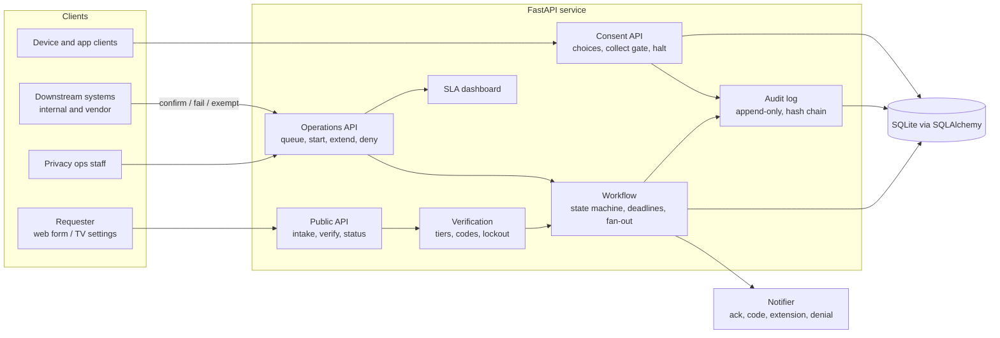
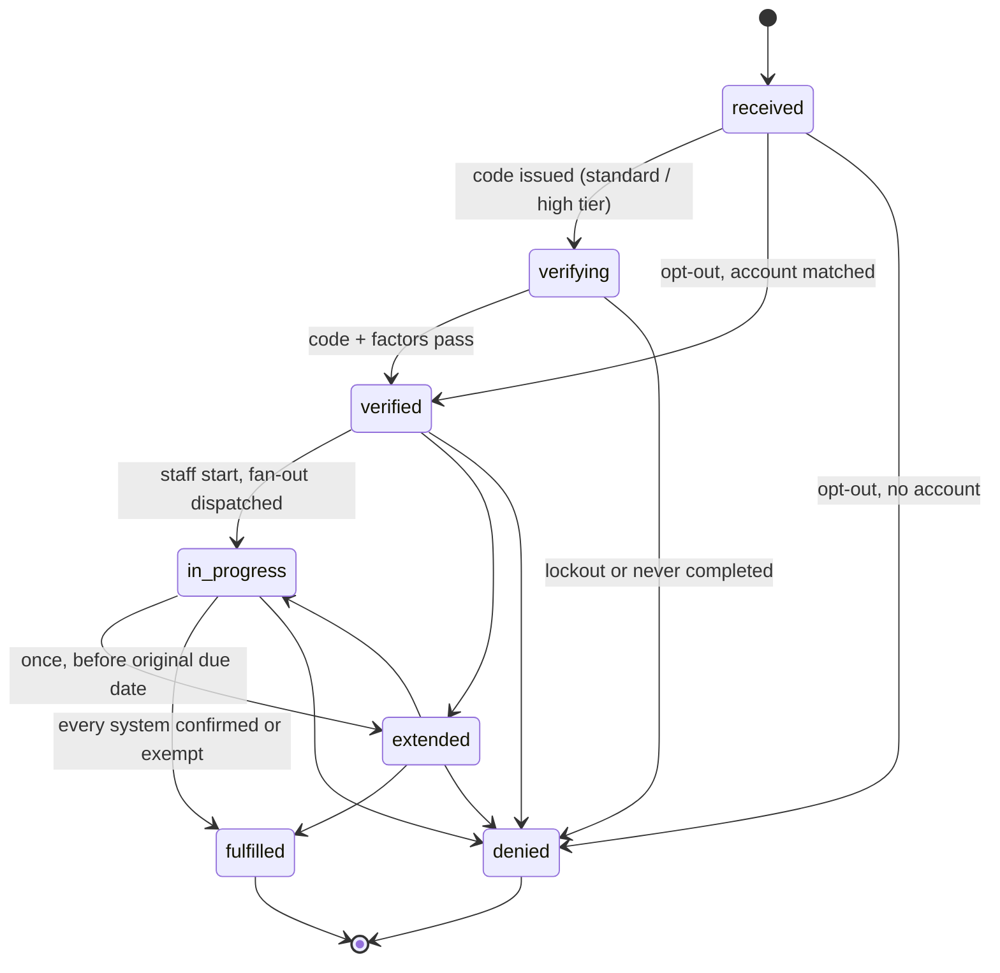

# privacy-request-portal

A reference data subject request (DSR) portal built the way a privacy program owner would want it run: every request verified in proportion to its risk, every deadline computed from a cited rule, every downstream deletion confirmed system by system, and every action written to a tamper-evident log that never stores more personal data than it needs.

It covers what tends to go wrong in practice. Deadlines slip because one vendor system never confirms. Extensions are taken too late or twice. Verification is either too weak for access requests or too strict for opt-outs. Audit logs end up holding the same personal data they are supposed to protect. The service makes each of those a rule in code, with a test behind it.

**Live demo:** https://deokhwajeong.github.io/demos/privacy-request-portal/ (generated from real service output on synthetic requests)

Draws on building a Smart TV privacy program for GDPR and CCPA with outside counsel.

## What it does

| Capability | Detail |
|---|---|
| Intake | Access, deletion, correction, opt-out of sale/sharing (CCPA) or objection (GDPR Art. 21). Acknowledgement sent at intake |
| Risk-based verification | Opt-out: account match only. Correction: one-time code to the email on file. Access and deletion: code plus a second account attribute. Lockout, code expiry, no account enumeration |
| Lifecycle | `received > verifying > verified > in_progress > fulfilled`, plus `extended` (once) and `denied` with a reason code. Every transition audited |
| Deadlines | GDPR one month, +2 months. CCPA 45 days, +45. CCPA opt-out 15 business days, no extension. Month-end clamping. Statute cited inline |
| Fan-out | Each verified request dispatches a task to every registered downstream system that supports it. Completes only when each system confirms (with an evidence reference) or an exemption with legal basis is recorded |
| Audit log | Append-only (database triggers and ORM guard), hash-chained, subject referenced by keyed hash. `/v1/audit/verify` detects edits and deletions |
| SLA dashboard | On time / at risk / breached for open requests; met / missed for closed; per-regime stats |
| Consent and collection | Per-purpose consent, collection gate that fails closed, program-wide halt, refusal counts as evidence |
| Housekeeping | Nightly sweep closes unverified requests; contact email redacted 30 days after closure |

## Architecture



## Request lifecycle



## Run it

Python 3.12.

```bash
python -m venv .venv && . .venv/bin/activate
pip install -r requirements-dev.txt
uvicorn app.main:app --reload
# open http://127.0.0.1:8000/docs
```

Reference data (fictional systems, purposes, and accounts) is seeded on startup. Staff endpoints need `X-Staff-Key: dev-staff-key` and `X-Actor: <your name>`.

```bash
curl -s localhost:8000/v1/requests -H 'content-type: application/json' \
  -d '{"regime":"gdpr","request_type":"deletion","email":"mara.lindqvist@example.com","account_id":"ACC-10021"}'

curl -s localhost:8000/v1/sla/dashboard -H 'X-Staff-Key: dev-staff-key' -H 'X-Actor: you'
```

Verification codes go to an in-memory outbox in this reference build (`app/notifier.py`); the API never returns them.

Settings are environment variables prefixed `PRP_` (see `app/config.py`): database URL, staff key, pseudonymization key, code TTL, attempt limits, verification window, contact retention days.

## Tests and lint

```bash
pytest          # 137 tests
ruff check . && ruff format --check .
```

Coverage by area: every state transition (allowed and refused), deadline math including month ends, leap years and business days, verification failures (wrong code, missing attribute, expiry, lockout, resend limits, account mismatch, bad ticket), fan-out confirmation, failure, retry and exemption, audit integrity (triggers, ORM guard, tamper and deletion detection, no email in the log), SLA classification, consent gate and halts, sweep and retention.

## Demo

```bash
python demo/build.py --out demo/dist
```

The builder runs the app in-process against a throwaway database, replays 17 synthetic requests through the real API with a controlled clock (July to October 2026), and writes the API responses to `demo/dist/data.js` beside a static page (plain HTML, CSS, JS; no external requests). CI runs the same build.

## Docs

| Document | Use |
|---|---|
| [Consent and data-collection spec template](docs/consent-and-collection-spec-template.md) | Purpose register, user controls, gate contract, change control, acceptance tests |
| [DSR operating procedure](docs/dsr-operating-procedure.md) | Roles, RACI, deadlines, internal SLAs, runbook, escalation |
| [Audit-readiness checklist](docs/audit-readiness-checklist.md) | ISMS-style controls mapped to evidence, with known gaps |
| [Vendor and law-firm coordination](docs/vendor-and-law-firm-coordination.md) | Turning counsel opinions into testable requirements across jurisdictions and an IT services partner |
| [Design decisions](docs/design-decisions.md) | Choices, trade-offs, and figures to confirm with counsel |

## Not legal advice

This is a generalized reference implementation for illustration. Statutory references reflect my reading at the time of writing and are flagged where uncertain in [Design decisions](docs/design-decisions.md). Confirm requirements with qualified counsel for your jurisdictions. All names, accounts, systems, and data in this repository are fictional.

## License

MIT. See [LICENSE](LICENSE).
